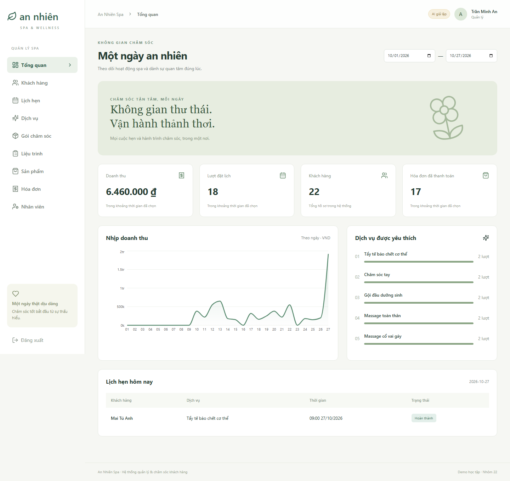

# An Nhiên Spa

Hệ thống demo cho đồ án **Hệ thống quản lý spa và chăm sóc sắc đẹp có tích hợp AI**. Giao diện tiếng Việt, tiền VND, giờ Việt Nam. Dữ liệu mẫu hoàn toàn hư cấu.



## Chức năng

- Ba vai trò: quản lý, lễ tân, kỹ thuật viên; kiểm tra quyền tại API và phạm vi khách hàng được phân công.
- Quản lý khách hàng, lịch sử hoàn thành; dịch vụ; gói chăm sóc; sản phẩm; tài khoản nhân viên.
- Đặt, đổi, hủy lịch nhiều dịch vụ nối tiếp; phân công và ngăn trùng lịch kỹ thuật viên/khách hàng.
- Liệu trình nhiều buổi, đặt lịch từ buổi và cập nhật tiến độ sau hoàn thành.
- Gói đã mua có quyền sử dụng chốt khi thanh toán; dành lượt khi đặt, giải phóng khi hủy, trừ chính thức khi hoàn thành.
- Hóa đơn dịch vụ đã thực hiện, sản phẩm và gói; giảm giá; thanh toán tiền mặt/chuyển khoản được nhân viên xác nhận thủ công; in hóa đơn demo.
- Dashboard doanh thu đã thanh toán, số lịch và dịch vụ phổ biến.
- Trợ lý gợi ý dịch vụ, nhắc lịch/chăm sóc sau dịch vụ và tóm tắt lịch sử. Prompt riêng; kiểm tra JSON, mã dịch vụ và số lượng gợi ý.
- Chế độ `mock` chạy ngay không cần key, được ghi nhãn **giả lập**; chế độ `gemini` gọi API thật khi được cấu hình.

## Công nghệ

Python 3.12+, FastAPI, SQLAlchemy, Alembic, SQLite; React 19, TypeScript 5.9, Vite 7, Tailwind 4, Recharts, Lucide. Node.js 22.12+ và pnpm 11 được dùng để build. Phiên bản chính xác trong `backend/requirements.txt` và `frontend/pnpm-lock.yaml`.

## Chạy trên Windows PowerShell

Máy cần cài Python 3.12+, Node.js 22.12+ và Git. Các lệnh dưới đây chạy từ bản clone của kho:

```powershell
git clone https://github.com/longtranyd-ui/AI.git
cd AI
python -m venv .venv
.\.venv\Scripts\python.exe -m pip install -r backend/requirements.txt
Copy-Item .env.example .env
cd backend
..\.venv\Scripts\python.exe -m alembic upgrade head
..\.venv\Scripts\python.exe -m app.seed
..\.venv\Scripts\python.exe -m uvicorn app.main:app --host 127.0.0.1 --port 8000
```

Giữ terminal Backend đang chạy. Mở terminal thứ hai từ thư mục `AI`:

```powershell
cd frontend
npm install -g pnpm@11
pnpm install --frozen-lockfile
pnpm dev
```

Mở **http://localhost:5173**. API docs: **http://127.0.0.1:8000/docs**. Không cần kích hoạt venv qua PowerShell vì các lệnh gọi trực tiếp Python trong venv.

Nếu đã có pnpm, bỏ qua lệnh cài pnpm toàn cục. Không chạy seed với dữ liệu thật. Seed có dữ liệu thì không ghi đè hoặc xóa dữ liệu; muốn khởi tạo lại, sao lưu `backend/spa.db` rồi đổi tên file trước khi chạy migration và seed.

## Chạy bản build với một máy chủ

```powershell
cd frontend
pnpm build
cd ../backend
..\.venv\Scripts\python.exe -m uvicorn app.main:app --host 127.0.0.1 --port 8000
```

Sau khi khởi động lại Backend, truy cập **http://127.0.0.1:8000**. Backend phục vụ `frontend/dist`; frontend dùng điều hướng nội bộ không cần cấu hình route fallback. `dist` không đưa vào Git; máy nhận cần build.

## Tài khoản demo

Mật khẩu chung: **`SpaDemo@123`**.

| Tài khoản | Vai trò |
| --- | --- |
| admin | Quản lý |
| letan, letan2 | Lễ tân |
| ktv1, ktv2, ktv3, ktv4 | Kỹ thuật viên |

Mật khẩu được băm scrypt. JWT có thời hạn 8 giờ; lưu tại sessionStorage. `JWT_SECRET` để trống thì mỗi lần khởi động sinh khóa mới và phiên cũ mất hiệu lực. Với môi trường dùng chung, đặt khóa ngẫu nhiên đủ dài và thay tài khoản demo.

## AI thật bằng Gemini

Chỉnh `.env` tại thư mục gốc rồi khởi động lại Backend:

```dotenv
AI_PROVIDER=gemini
GEMINI_API_KEY=your_own_key
AI_MODEL=your_available_model_id
AI_TIMEOUT_SECONDS=25
```

Chọn tên mô hình có quyền truy cập trong tài khoản của bạn. Key chỉ lưu Backend, không dùng tên biến `VITE_...`. Kết nối sử dụng REST `generateContent` theo [tài liệu chính thức Gemini](https://ai.google.dev/api/generate-content) và [JSON output](https://ai.google.dev/gemini-api/docs/structured-output). Không tự chuyển sang mock nếu API thật lỗi. Cần key của bạn để thử AI thật; phiên bàn giao chỉ xác minh mock và xử lý lỗi cấu hình.

Giới hạn 10 yêu cầu/phút/tài khoản trong một tiến trình demo. Nội dung AI là bản nháp để nhân viên kiểm tra, không tư vấn y khoa và không tự gửi tin nhắn. Bộ kiểm tra cấu trúc không thể bảo đảm loại bỏ mọi nội dung suy diễn của mô hình.

## Kiểm thử

```powershell
cd backend
..\.venv\Scripts\python.exe -m pytest -q
cd ../frontend
pnpm build
pnpm exec playwright install chromium
pnpm test:e2e
```

Playwright cần Backend đang chạy cổng 8000 với dữ liệu seed và AI mock. Các ca UI tạo dữ liệu hư cấu mới, vì vậy dùng cơ sở dữ liệu demo riêng nếu cần giữ nguyên bộ dữ liệu trình diễn. Backend tests dùng SQLite tách biệt, không ghi đè `spa.db`.

## Cấu trúc

```text
backend/app/             API, xác thực, schema, nghiệp vụ và mô hình dữ liệu
backend/app/ai/prompts/  System prompt và mẫu cho từng tác vụ
backend/migrations/     Alembic
backend/tests/          Kiểm thử API, đồng thời, thanh toán và AI
frontend/src/           React, TypeScript, giao diện
frontend/e2e/           Kiểm thử trình duyệt
docs/                   ERD, quy tắc, kịch bản demo, báo cáo kiểm thử
docs/ai-evidence/       Nhật ký thực tế và mẫu ghi minh chứng
```

## Phạm vi demo

Chưa có SMS/email thật, đối soát ngân hàng, hoàn tiền, cổng khách hàng, quản lý ca/giường/phòng và kho nhập xuất đầy đủ. Mỗi liệu trình tạo bằng giao diện dùng một dịch vụ lặp qua nhiều buổi; API hỗ trợ danh sách dịch vụ khác nhau theo buổi. Liệu trình đã tạo không có màn hình đổi cấu trúc; lịch từng buổi vẫn đổi/hủy được.

Danh sách lịch và hóa đơn giới hạn 300 bản ghi gần nhất, khách hàng có phân trang. Không dùng dữ liệu hay kết quả kiểm thử giả làm bằng chứng thử mô hình thật. Đây là demo localhost, chưa được đánh giá để vận hành production.

## Tài liệu đồ án

- [Kiến trúc và ERD](docs/data-model.md)
- [Phân quyền](docs/permissions.md)
- [Quy tắc lịch và thanh toán](docs/business-rules.md)
- [Kịch bản demo](docs/demo-script.md)
- [Đối chiếu yêu cầu](docs/requirements-traceability.md)
- [Kết quả kiểm thử](docs/test-report.md)
- [Minh chứng sử dụng AI](docs/ai-evidence/README.md)
- [Dàn ý thuyết trình](docs/presentation-outline.md)
