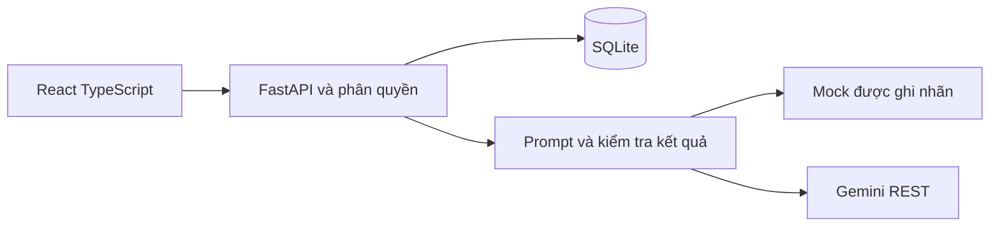
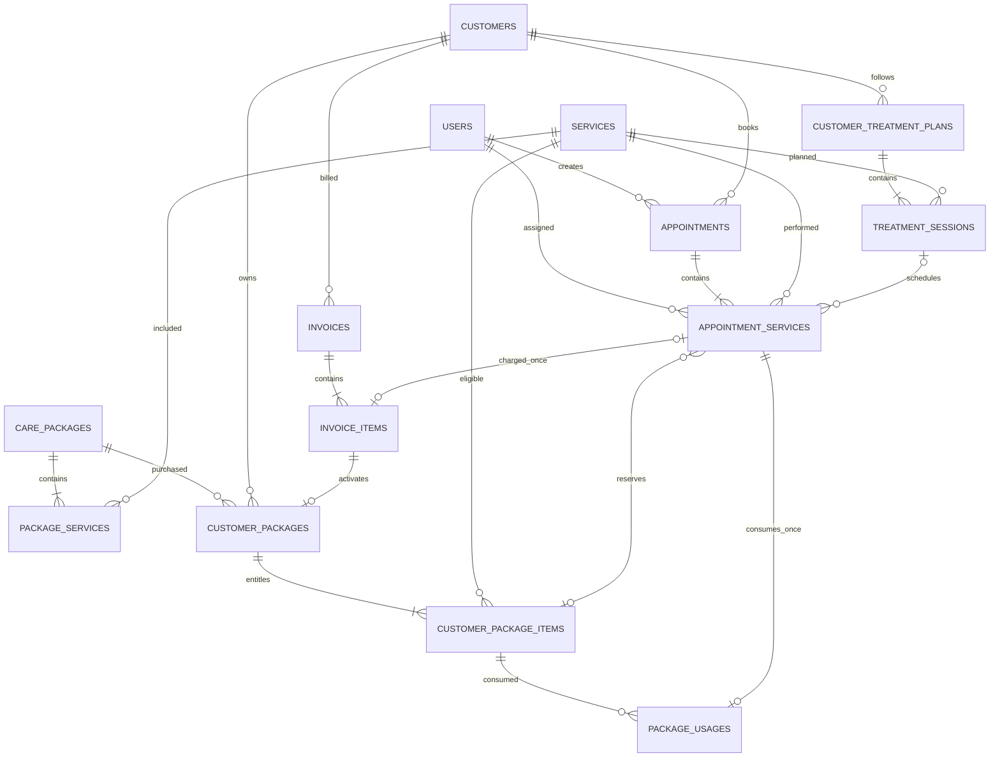

# Kiến trúc và dữ liệu

Frontend gọi API FastAPI qua cùng origin hoặc Vite proxy. Backend kiểm tra JWT, vai trò và phạm vi dữ liệu, sau đó đọc/ghi SQLite. AI provider nhận phần dữ liệu Backend chọn, không có kết nối trực tiếp CSDL.

Các cột và ràng buộc chính xác nằm trong backend/app/db.py. Giá VND là Integer, thời điểm ISO UTC. Các khóa ngoại bắt buộc được bật bằng PRAGMA. Reference sản phẩm/gói của invoice_items được kiểm tra trong service ứng với kind; đây là tham chiếu đa hình, không phải FK trực tiếp.

Số buổi hoàn thành tính từ treatment_sessions. Lượt gói khả dụng = tổng mua − lượt sử dụng − lịch đang dành. Invoice item dịch vụ và package usage có unique appointment_service_id. Giá, thời lượng dịch vụ được chốt khi đặt; tên/đơn giá khoản mục chốt khi lập hóa đơn; thành phần quyền gói chốt khi thanh toán.

Migration ban đầu dùng metadata của mô hình hiện tại cho bản demo đầu tiên. Nếu phát triển phiên bản mới, cần tạo revision migration tường minh cho thay đổi mới; không sửa mô hình rồi dùng lại revision cũ như một cách nâng cấp dữ liệu.
